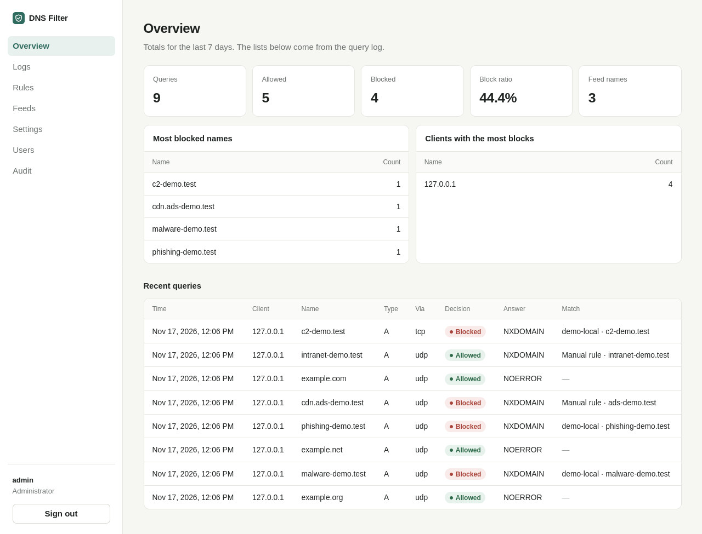

# DNS Filter

DNS Filter is a protective DNS forwarder for a lab. One Go process receives queries, blocks names that match a manual rule or a threat feed, and forwards everything else to an upstream resolver. It counts every query, keeps the query log you ask it to keep, and serves a small console for the people operating it.

It is not a recursive resolver, and it does not cache answers. It does not speak DNS over HTTPS, TLS, or QUIC, and it does not intercept traffic on the path. Clients are pointed at it, or a lab resolver forwards to it.

The demonstration blocklist uses only names under the reserved `.test` domain. `example.com` is the name used to show an allowed query. Do not add real malicious domains to the demo list, and do not look those names up while trying the filter.

## Architecture

```
                 UDP/TCP DNS                         UDP, then TCP if truncated
 test client  ----------------->  dnsfilter  ------------------------------>  upstream resolver
                                       |  |
                                       |  +-- policy snapshot (allow, deny, feeds)
                                       |
                                       +-- SQLite: counts, log, rules, feeds, users, settings, audit
                                       |
 operator browser  -- HTTP on loopback --> console (embedded HTML, CSS, and JS)
```

A query is decided in this order:

1. Manual allow, exact name.
2. Manual allow, name and subdomains.
3. Manual deny, exact name.
4. Manual deny, name and subdomains.
5. Feed name, including subdomains.
6. Otherwise the query is forwarded.

A suffix matches on a label boundary. `example.test` matches `example.test` and `a.example.test`. It does not match `notexample.test`. The longest matching suffix wins. If two feeds list the same name, the first feed in configuration order is the one recorded.

Names that are not valid DNS names are not compared with the blocklist. The filter answers `FORMERR` and logs the query as `ERROR`.

## What you need

Go 1.26 or newer. The SQLite driver in this module, `modernc.org/sqlite` v1.62, does not build with older toolchains. The commands below were run with Go 1.27.4.

`dig` is useful for the demonstration. The console is served by the filter itself. There is no Node.js step and no separate database server.

## Quick start

```sh
make run
```

That builds the binary and starts it. Nothing needs to be exported first. On the first run the filter writes `config.json` from `config.example.json` and creates the database in `data/`. Then open <http://127.0.0.1:8080>, sign in as `admin` with the password `admin`, and choose a new password when asked.

Without `make`, the same thing is `go build -o dnsfilter ./cmd/dnsfilter` followed by `./dnsfilter`.

| Command | What it does |
| --- | --- |
| `make` | Build `./dnsfilter` |
| `make run` | Build and start |
| `make port53` | Build and allow the binary to bind port 53 without root |
| `make test` | Check formatting, run `go vet`, and run the tests with the race detector |
| `make clean` | Remove the binary |

The binary carries the console and the database migrations, so `./dnsfilter`, `config.json`, and the feed files are all a machine needs. A `config.json` that already exists is never overwritten. If `-config` names a file that does not exist, the filter stops instead of creating it.

## Configuration

`config.example.json` listens for DNS on `127.0.0.1:5354`, forwards to `1.1.1.1:53`, answers blocked names with `REFUSED`, and serves the console on `127.0.0.1:8080`. The database file is `./data/dnsfilter.db`. The demo feed is `./testdata/demo-blocklist.txt`.

Paths in the file are resolved from the directory that contains the config file. They are not resolved from the shell’s current directory. A feed is either a local `path` or an `https` URL, not both, and not plain HTTP. Feed names are a short token such as `demo-local`. The format is `domains` (one name per line) or `hosts` (`0.0.0.0 name` or `127.0.0.1 name`).

`upstream_timeout_seconds` is 1 to 30. `logging.retention_days` is 1 to 3650. `feeds.sync_interval_hours` is 1 to 720. `blocked_rcode` is `REFUSED`, `SERVFAIL`, or `NXDOMAIN`.

The file gives the starting values. The blocked answer, the upstream resolver and its timeout, log retention, the feed sync interval, what gets logged, and the feed list can then be changed in the console, and a value saved there wins over the file from then on. Listen addresses and the database path stay in the file because changing them needs a restart. At startup the process log lists any values that come from the console.

## First sign-in

On an empty database the filter creates one administrator, `admin` with the password `admin`, and logs a warning saying so. That password only opens the Account page: the rest of the console and its API stay closed until a new password is chosen. Do this before the console is reachable by anyone else.

The variables below are optional. Use them only to start with chosen accounts instead of `admin`/`admin`, for example in an automated setup. The analyst pair is optional too. Set both variables of a pair or neither.

```sh
export DNSFILTER_BOOTSTRAP_ADMIN_USER=admin
export DNSFILTER_BOOTSTRAP_ADMIN_PASSWORD='choose-a-password'
export DNSFILTER_BOOTSTRAP_ANALYST_USER=analyst
export DNSFILTER_BOOTSTRAP_ANALYST_PASSWORD='choose-another-password'
```

Accounts are created only when the database has no users, so a later start needs no variables. Further accounts are added on the Users page. Passwords are 8 to 72 characters and are stored as bcrypt hashes. The process log records the username and role, not the password.

## Run it locally

`127.0.0.1:5354` does not need extra privileges. The example avoids 5353 because mDNS usually holds it. If startup says a port is already in use, the message names the setting to change in `config.json`.

Open the console at <http://127.0.0.1:8080>. An administrator can change rules, feeds, settings, and accounts. An analyst can read the overview, logs, rules, feeds, and settings. The Users and Audit pages and every change are limited to an administrator. Signing out clears the session cookie.

## Run it on port 53

Use port 53 only on an isolated lab network. In `config.json`, set `listen_udp` and `listen_tcp` to this machine's lab address, for example `192.168.209.128:53`. Keep the console on loopback unless the lab explicitly needs it elsewhere. If the console is not on loopback, the process logs a warning.

```sh
make port53
./dnsfilter
```

`make port53` asks for `sudo` once to grant the binary permission to bind ports below 1024, so the filter itself does not run as root. A rebuild drops that permission, so use `make port53` instead of `make` whenever you rebuild. `sudo ./dnsfilter` also works, but then the files it creates in `data/` belong to root.

Point the test client’s DNS server at the lab address of this machine. A system resolver always uses port 53, so a filter on port 5354 is queried with `dig` rather than by changing the whole computer’s DNS.

## Queries to try

Allowed name, UDP:

```sh
dig @127.0.0.1 -p 5354 example.com A
```

The status is `NOERROR` and the answer comes from upstream.

The same query over TCP:

```sh
dig @127.0.0.1 -p 5354 example.com A +tcp
```

A name on the demo feed:

```sh
dig @127.0.0.1 -p 5354 malware-demo.test A
```

The status is `REFUSED` (or the blocked answer chosen on the Settings page), the answer section is empty, and the filter does not ask upstream. `phishing-demo.test` and `c2-demo.test` behave the same way. A name that only shares a suffix by spelling, such as `notmalware-demo.test`, is forwarded.

If upstream does not answer before `upstream_timeout_seconds`, the filter returns `SERVFAIL` and logs the query as `ERROR`. If the upstream UDP answer is truncated, the filter retries that query over TCP and returns the TCP answer.

## Console pages

| Page | What it shows |
| --- | --- |
| Overview | Query counts and block ratio for the retention window, top blocked names and clients, recent queries |
| Logs | What gets logged, then the query log filtered by name and by allowed, blocked, or error |
| Rules | Manual allow and deny rules |
| Feeds | Feeds, how many names loaded, and the last sync; administrators add, sync, and remove them |
| Settings | Blocked answer, upstream resolver and timeout, log retention, feed sync interval |
| Users | Accounts and roles, temporary passwords, password resets |
| Audit | Sign-ins, password and account changes, settings, rules, and feeds |

The account name at the bottom of the sidebar opens the Account page, where anyone signed in changes their own password. Changing it signs out that account's other sessions.

Screenshots from a local run are in `docs/screenshots/`. A timed walk-through is in `docs/demo-script.md`.



## Settings in the console

A saved setting applies to the next query or the next timer tick. Nothing restarts. Each field says whether its value comes from `config.json` or was set in the console, by whom, and when. A value is checked by the same rules as the file, and a rejected one is named on the form.

Changing the feed sync interval moves the next sync to the last sync plus the new interval. Shortening retention deletes the older rows at once.

## Accounts

New accounts and reset passwords are temporary. The person signs in with the temporary password and must choose their own before anything else opens. A reset signs that account out everywhere. An administrator cannot delete or reset their own account from the Users page, and the last administrator cannot be deleted.

## What is stored for a query

The action is `ALLOWED`, `BLOCKED`, or `ERROR`. There is no separate action for an allow exception. When an allow rule is the reason a name was forwarded, the row is `ALLOWED` with match source `manual` and the rule’s domain in the match column. A normal forward leaves the match empty. A manual deny uses match source `manual`. A feed block uses the feed’s name as the source and the feed’s domain, which may be a parent of the name that was queried.

Every query adds one to a daily count of allowed, blocked, or error. The counts hold no names or addresses. Whether the query is also stored as a row depends on the choice at the top of the Logs page:

| Choice | Rows stored |
| --- | --- |
| All queries | Every query, with client, name, and answer |
| Blocked only | Blocked queries only |
| Nothing | None |

The overview totals and block ratio come from the daily counts for the days inside the retention window, so they stay complete whatever the logging choice. The ratio is shown to one decimal place. The top blocked names and clients come from the stored rows.

## Feeds

Blank lines and lines that start with `#` are ignored. In `hosts` files, a `#` comment may follow the name. A line that does not match the format is counted as rejected. If a sync finds no valid names and at least one rejected line, the previous list stays in place and the feed status becomes `error`. An empty file, or a file that is only comments, replaces the list with nothing. A missing file, a body over 10 MiB, a non-HTTPS URL, or an HTTP error does the same: the last good list remains.

The console’s Sync button reloads that feed’s saved source. Feeds are fetched again on the sync interval. The first sync runs at startup and does not stop the process if it fails.

At first the feed list follows `config.json`. When an administrator adds or removes a feed in the console, the list moves to the console for good, and the feeds in the file are no longer applied; the process log says so at startup. A new feed is either an absolute file path on this machine or an `https` address, and it is synced as soon as it is added. A file path can name any file the process can read. The console shows only how many lines were loaded or rejected, never the file's contents, and only an administrator can add one. Removing a feed stops its names being blocked at once.

## Sessions, cookies, and limits

A session lasts 12 hours. The cookie is `dnsfilter_session`. It is `HttpOnly`, `SameSite=Strict`, and `Secure` when the console itself is served over HTTPS. The browser sends `X-CSRF-Token` on any request that changes state. If the request includes an `Origin` header, that origin must match the console’s host.

Five failed sign-ins from the same client address within 10 minutes are rejected until the window passes. The limit uses the connection address, not `X-Forwarded-For`. Wrong current passwords on the Account page are limited the same way per account.

The events and audit APIs accept a page size from 1 to 100. A larger `limit` is rejected. Query rows and daily counts older than the retention period are deleted at startup, then once an hour and whenever retention is changed. Expired sessions are deleted every 10 minutes.

## Tests

```sh
make test
```

That checks `gofmt`, runs `go vet ./...`, and runs `go test -race ./...`. DNS tests use a local stand-in resolver. They do not query public malicious names. The command output from the verification run is in `docs/test-report.md`.

## Project layout

```
cmd/dnsfilter          process entrypoint; writes config.json on a first run
internal/config        JSON configuration
internal/settings      console settings over the file values
internal/store         SQLite and migrations
internal/policy        normalization and the decision order
internal/upstream      UDP query, TCP retry when truncated
internal/dnsserver     UDP and TCP listeners
internal/feeds         feed files and HTTPS downloads
internal/auth          passwords, sessions, roles
internal/httpapi       JSON API and console pages
internal/reporting     overview queries
internal/app           startup and shutdown
web                    HTML, CSS, and JS embedded in the binary
testdata               the .test demonstration list
```

## Left for later

Transparent redirection, encrypted DNS, a recursive resolver, a cache, detection models, SIEM or metrics export, containers, and a block page are out of scope for this version. They need their own plan. The filter’s job here is to refuse the configured names, forward the rest, and show what it did.
